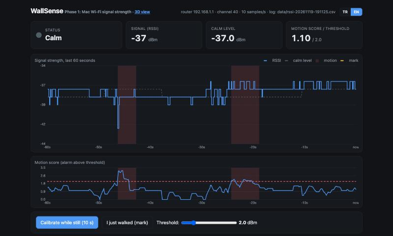
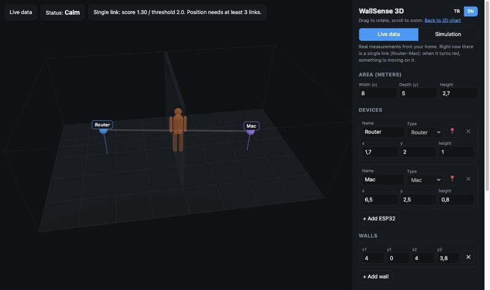
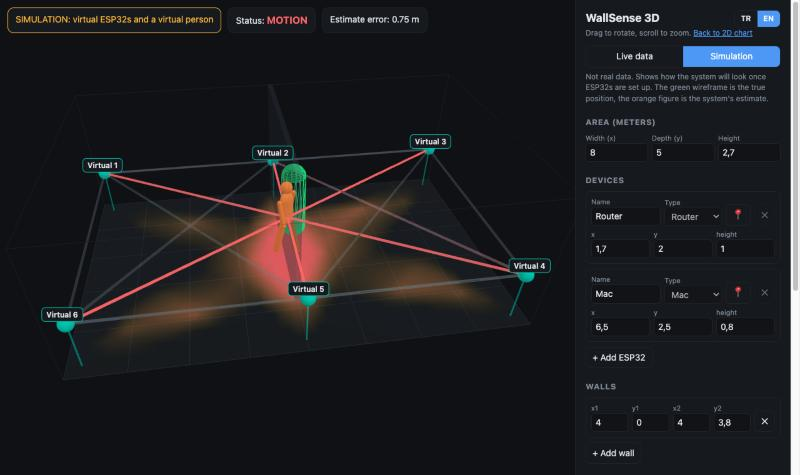

# WallSense

**English** · [Türkçe](README.tr.md)

**Detect motion behind walls using your home Wi-Fi.**

Wi-Fi signals pass through walls. When someone steps into the path of a signal, their body absorbs and reflects part of it.
WallSense measures that change and shows it on a live chart and on a 3D floor plan of your home.



> [!WARNING]
> **Version 0.1.0: early prototype.** This is not a finished product.
> Right now WallSense works with **a single signal link** (your router ↔ your Mac) and **cannot tell where a person is**,
> only that something is moving on that link. ESP32 hardware support is **not implemented yet**.
> The multi-device 3D tracking you see in the screenshots is a **simulation**, not real data.
> Please read [What works and what doesn't](#what-works-and-what-doesnt) before using it.

---

## Contents

- [What works and what doesn't](#what-works-and-what-doesnt)
- [How it works](#how-it-works)
- [Quick start](#quick-start)
- [3D view](#3d-view)
- [Limitations](#limitations)
- [Roadmap](#roadmap)
- [Privacy and responsible use](#privacy-and-responsible-use)
- [Project structure](#project-structure)
- [Contributing](#contributing)
- [Related work](#related-work)
- [License](#license)

---

## What works and what doesn't

### ✅ Works today

| Feature | Notes |
|---|---|
| Motion detection on the Router–Mac link | Uses the Mac's built-in Wi-Fi signal strength (RSSI). No extra hardware. |
| Telling walking from standing | A walking person makes the signal fluctuate; a standing person causes a steady drop. |
| Detecting a person who stands still | The "calm level" is frozen while motion is present, so a still person keeps being detected (up to 60 s). |
| Live 2D chart | Signal, calm level, motion score, threshold, calibration and manual marks. |
| 3D floor plan | Edit room size, walls and device positions. The link glows red and a human figure appears when motion is detected. |
| Data logging | Every session is saved as CSV in `data/` for later analysis and training. |
| Simulation mode | 6 virtual ESP32s and a virtual person, to show how multi-link tracking will work. |
| Turkish and English UI | TR / EN toggle on both pages. |

### ❌ Does not work yet

| Missing | Why |
|---|---|
| **Finding where a person is** | A single link gives one number. Someone crossing near the router and someone crossing near the Mac look the same. Position needs at least 3 links (see [How it works](#how-it-works)). The human figure's spot on the link is **illustrative**: you choose it with a slider. |
| **ESP32 / CSI support** | Planned for the next version. Today the only data source is the Mac's RSSI. |
| **Real multi-device tracking** | The 3D tracking with 6 devices is a **simulation**. Its accuracy (~0.3–0.6 m) is measured under ideal, noise-free assumptions and real-world results will be worse. |
| **Motion away from the link** | Only motion near the straight line between the router and the Mac is detected. |
| **Pose / skeleton / images** | WallSense does not and cannot produce camera-like images or body poses from a single link. |
| **Other operating systems** | macOS only (uses Apple's CoreWLAN). |
| **Counting people, identifying people** | Not supported. |

---

## How it works

### 1. Physics

Your router and your Mac are constantly talking over radio waves (2.4 / 5 GHz). Those waves pass through drywall, brick and wood.
The human body is mostly water, so it absorbs and reflects these frequencies. When someone moves between the two devices,
the signal that reaches the Mac changes.

```
[Router] ~~~~~~~~~ wall ~~~~~~~~~ [Mac]
               ↑
     someone crossing here
     weakens / disturbs the signal
```

### 2. Measuring

- `rssi_reader.swift` reads the Mac's received signal strength (RSSI, in dBm) about **10 times per second** via CoreWLAN.
- The server pings the router 10 times per second in the background. macOS updates RSSI much more often when there is traffic.

### 3. Detecting motion

`server.py` turns the raw signal into a **motion score**:

| Value | Meaning |
|---|---|
| **Calm level** | Median of the last 20 seconds *without* motion. Frozen while motion is detected. |
| **Deviation** | How far the last 1 second's average is from the calm level. A standing person raises this. |
| **Fluctuation** | Standard deviation of the last 2 seconds. A walking person raises this. |
| **Motion score** | Deviation + fluctuation. Above the threshold means "motion". |

- **Calibration:** press the button while nobody is moving. The threshold is set just above the normal noise of your room (minimum 1.5 dBm).
- **Walking vs. standing:** if fluctuation is above half the threshold, the person is considered to be walking.
- **Relearning:** if the alarm lasts longer than 60 seconds, the environment is assumed to have changed for good
  (a door was closed, furniture was moved) and the calm level is relearned.

### 4. Locating a person (needs more links)

With several devices, every pair forms a link. A person only disturbs the links they are close to.
`viz3d/rti.js` uses **radio tomographic imaging**: the area is split into 20 cm cells, each link affects a thin ellipse
with the two devices as its foci, and the place where the disturbed links intersect is the person's position.

```
   A ─────────── B
   │ ╲         ╱ │
   │   ╲     ╱   │       6 devices = 15 links
   │     ╲ ╱     │
   │     ╱ ╲  🚶 │       only the links near the person light up
   │   ╱     ╲   │
   F ─────────── C
```

With a single link there is nothing to intersect, which is why the current version cannot locate anyone.

---

## Quick start

**Requirements:** macOS, Xcode command line tools (`swiftc`), Python 3.10+, a Wi-Fi connection.
No Python packages needed. The 3D page loads three.js from a CDN, so it needs internet access.

```bash
git clone https://github.com/captainulfur/WSense.git
```

```bash
cd WSense && ./run.sh --open
```

On the first run it compiles the Swift reader, then opens the live chart at `http://127.0.0.1:8765`.
Press `Ctrl+C` in the terminal to stop.

**First test:**

1. Put the router outside the room and the Mac inside it, so the line between them passes through the wall.
2. While nobody is moving, press **Calibrate while still** (10 s).
3. Have someone walk between the router and the Mac. Press **I just walked** as they pass.
4. If the orange mark lines line up with the red "motion" areas, it is working.

**Options:**

| Option | Default | Description |
|---|---|---|
| `--threshold` | `2.0` | Starting threshold in dBm (calibration overrides it) |
| `--no-ping` | off | Don't ping the router (RSSI updates less often) |
| `--port` | `8765` | Port for the local web page |
| `--interval-ms` | `100` | Time between measurements |
| `--open` | off | Open the page in your browser |

---

## 3D view

While the server is running, open `http://127.0.0.1:8765/3d` (or click "3D view" on the 2D page).

**Live data** shows your real Router–Mac link. When motion is detected the link turns red, an orange trail appears on the floor
along the link, and a human figure appears on it. The figure walks or stands depending on what the signal says.
Its position along the link is set with the slider in the side panel (for example where the door is), **not measured**.



**Simulation** shows how tracking will look with 6 ESP32s. The green wireframe is the virtual person's true position,
the orange figure is where the algorithm thinks they are. **This is not real data.**



Use the right panel to set the room size, walls and device positions (click 📍, then click on the floor).
**Save** writes the layout to `config/room.json`.

---

## Limitations

Please read these before drawing conclusions from what you see.

- **One link, no position.** See [What doesn't work](#-does-not-work-yet).
- **RSSI is coarse.** macOS reports whole dBm values that naturally fluctuate by ±1 dBm. A person crossing usually causes a drop
  of 3–8 dBm. Small or slow movements, or movement far from the link, can be missed.
- **Placement matters a lot.** It works best when the router and the Mac are a few meters apart with the area you care about between them.
  If the Mac is right next to the router, almost nothing will be detected.
- **Environment changes cause false alarms.** Doors, fans, pets, microwave ovens and other Wi-Fi traffic can all move the signal.
- **Thick concrete and metal** block most of the signal.
- **macOS only.** It depends on Apple's CoreWLAN framework.
- **Limited testing.** Developed and tested in one home: macOS 26, 5 GHz Wi-Fi, ~10 samples per second, ±1 dBm noise when calm.
  Your results may differ. Please report them.
- **The simulation is optimistic.** It assumes a clean signal model. Real ESP32 data will be noisier.

---

## Roadmap

| Version | Goal | Status |
|---|---|---|
| **0.1** | Mac RSSI, single link, 2D chart, 3D view, simulation, TR/EN | ✅ This release |
| **0.2** | ESP32-S3 CSI support (50+ subcarriers, ~100 samples/s) feeding the same charts | 🔜 Next |
| **0.3** | Two ESP32s on either side of the Router–Mac link: first real position measurement along the link | Planned |
| **0.4** | Recording labelled data ("empty", "walking", "sitting") and training a simple classifier | Planned |
| **0.5+** | ESP32 network (4–6 devices): real version of the 3D simulation | Planned |

---

## Privacy and responsible use

- **Everything stays on your machine.** The server only listens on `127.0.0.1`. No data is sent anywhere.
  Recordings are plain CSV files in `data/`, which is excluded from git.
- **Use it only on your own network and in your own home.** Do not use WallSense to monitor people without their knowledge or consent.
- **It is not a security, safety or medical device.** Do not rely on it for intrusion detection, fall detection or health monitoring.

---

## Project structure

| File | Purpose |
|---|---|
| `run.sh` | Compiles the reader (if needed) and starts the server |
| `phase1_rssi/rssi_reader.swift` | Reads RSSI via CoreWLAN, prints one JSON line per measurement |
| `phase1_rssi/server.py` | Motion detection, CSV logging, live stream (Server-Sent Events), room settings API |
| `phase1_rssi/index.html` | 2D live chart |
| `viz3d/room3d.html` | 3D view (three.js) |
| `viz3d/rti.js` | Radio tomographic imaging (position estimation) |
| `viz3d/i18n.js` | Turkish / English UI text |
| `docs/images/` | Screenshots |
| `config/room.json` | Your saved floor plan (created on first save, not in git) |
| `data/` | Measurement logs (not in git) |

Only the Python standard library is used. No build step for the web pages.

---

## Contributing

This is an early, open project and contributions are welcome:

- **Test reports:** does it detect motion in your home? What was your setup (distance, wall type, router band)?
- **ESP32 CSI support:** the most important next step.
- **Detection improvements:** better thresholds, fewer false alarms.
- **Translations:** add a language in `viz3d/i18n.js`.

Please open an issue before large changes.

---

## Related work

- **Radio tomographic imaging:** J. Wilson and N. Patwari, *Radio Tomographic Imaging with Wireless Networks*, IEEE Transactions on Mobile Computing, 2010. The method behind `viz3d/rti.js`.
- **Espressif `esp-csi`:** official tools for reading CSI on ESP32 boards, planned as the base for version 0.2.
- **[RuView](https://github.com/ruvnet/RuView):** a larger Wi-Fi sensing project with ESP32 CSI firmware. Its own documentation notes that
  pose estimation from a single ESP32 is still experimental; presence and motion detection are the realistic parts.
  WallSense was started after reviewing it, with the goal of a small, honest, easy-to-read starting point.

---

## License

[MIT](LICENSE) © 2026 captainulfur
