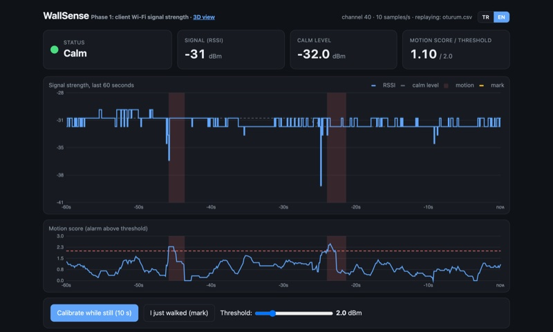
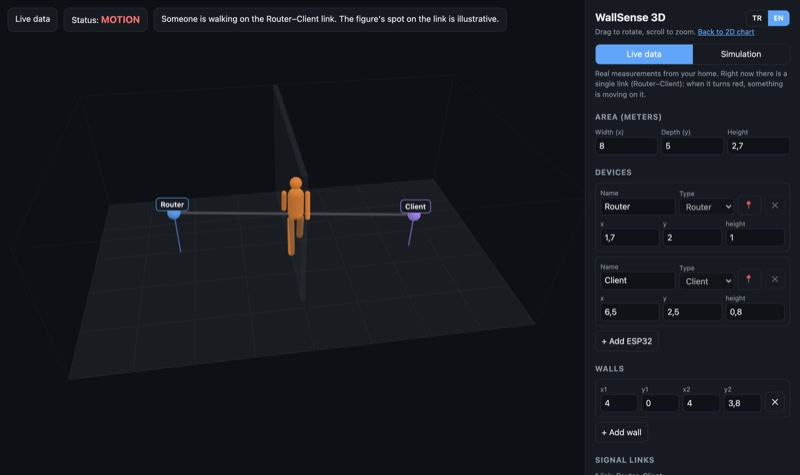
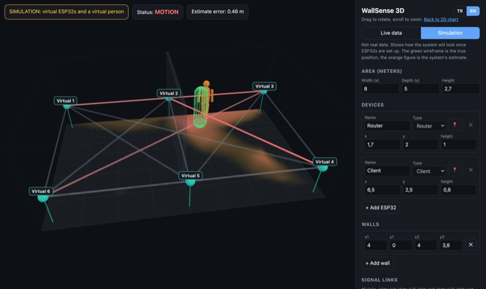

# WallSense

[English](README.md) · **Türkçe**

**Ev Wi-Fi'ı ile duvar arkasındaki hareketi algılama.**

Wi-Fi sinyali duvarlardan geçer. Biri sinyalin yolundan geçince vücudu sinyalin bir kısmını emer ve yansıtır.
WallSense bu değişimi ölçer, canlı bir grafikte ve evinizin 3D planında gösterir.



> [!WARNING]
> **Sürüm 0.2.0: erken prototip.** Bitmiş bir ürün değildir.
> WallSense şu an **tek bir sinyal hattı** (router ↔ client, yani WallSense'i çalıştıran Wi-Fi'lı bilgisayar) ile çalışır
> ve **kişinin nerede olduğunu bulamaz**. Sadece o hatta bir şeyin hareket ettiğini söyler.
> Client macOS, Linux ya da Windows olabilir; Linux ve Windows okuyucuları yeni ve **deneysel**.
> ESP32 donanım desteği **henüz eklenmedi**.
> Ekran görüntülerindeki çok cihazlı 3D takip bir **simülasyondur**, gerçek veri değildir.
> Kullanmadan önce lütfen [Neler çalışıyor, neler çalışmıyor](#neler-çalışıyor-neler-çalışmıyor) bölümünü okuyun.

---

## İçindekiler

- [Neler çalışıyor, neler çalışmıyor](#neler-çalışıyor-neler-çalışmıyor)
- [Nasıl çalışır?](#nasıl-çalışır)
- [Hızlı başlangıç](#hızlı-başlangıç)
- [3D görünüm](#3d-görünüm)
- [Sınırlamalar](#sınırlamalar)
- [Yol haritası](#yol-haritası)
- [Gizlilik ve sorumlu kullanım](#gizlilik-ve-sorumlu-kullanım)
- [Proje yapısı](#proje-yapısı)
- [Katkıda bulunma](#katkıda-bulunma)
- [Benzer çalışmalar](#benzer-çalışmalar)
- [Lisans](#lisans)

---

## Neler çalışıyor, neler çalışmıyor

### ✅ Bugün çalışanlar

| Özellik | Açıklama |
|---|---|
| Router–Client hattında hareket algılama | Client'ın kendi Wi-Fi sinyal gücünü (RSSI) kullanır. Client, WallSense'i çalıştıran bilgisayardır: macOS, Linux ya da Windows. Ek donanım gerekmez. |
| Yürüme / durma ayrımı | Yürüyen kişi sinyali oynatır, duran kişi sabit bir düşüş yaratır. |
| Hareketsiz duran kişiyi algılama | Hareket varken "sakin seviye" dondurulur, böylece duran kişi algılanmaya devam eder (60 sn'ye kadar). |
| Canlı 2D grafik | Sinyal, sakin seviye, hareket skoru, eşik, kalibrasyon ve elle işaretleme. |
| 3D ev planı | Oda ölçüleri, duvarlar ve cihaz konumları düzenlenir. Hareket olunca hat kırmızılaşır ve bir insan figürü belirir. |
| Veri kaydı | Her oturum `data/` klasörüne CSV olarak kaydedilir (analiz ve eğitim için). |
| Kayıt tekrar oynatma | `--replay data/....csv` kayıtlı bir oturumu aynı algılayıcıdan, gerçek hızında geçirir. Wi-Fi gerekmez. |
| Simülasyon modu | 6 sanal ESP32 ve sanal bir kişi ile çok hatlı takibin nasıl çalışacağını gösterir. |
| Türkçe ve İngilizce arayüz | İki sayfada da TR / EN düğmesi. |

### ❌ Henüz çalışmayanlar

| Eksik | Neden |
|---|---|
| **Kişinin yerini bulma** | Tek hat tek bir sayı verir. Router'a yakın geçen biriyle client'a yakın geçen biri aynı görünür. Konum için en az 3 hat gerekir ([Nasıl çalışır?](#nasıl-çalışır)). İnsan figürünün hat üzerindeki yeri **temsilidir**, kaydırıcıyla siz seçersiniz. |
| **ESP32 / CSI desteği** | Bir sonraki sürümde. Şu an tek veri kaynağı client'ın RSSI değeri. |
| **Gerçek çok cihazlı takip** | 6 cihazlı 3D takip bir **simülasyondur**. Doğruluğu (~0,3–0,6 m) ideal, gürültüsüz varsayımlarla ölçüldü. Gerçek sonuçlar daha kötü olacaktır. |
| **Hattan uzaktaki hareket** | Sadece router ile client arasındaki düz çizgiye yakın hareketler algılanır. |
| **Poz / iskelet / görüntü** | WallSense tek hattan kamera benzeri görüntü ya da vücut pozu üretmez, üretemez. |
| **Telefon ve tablet** | Desteklenmiyor. Client, Python çalıştıran bir bilgisayardır (macOS, Linux ya da Windows). |
| **Kişi sayma, kişi tanıma** | Desteklenmiyor. |

---

## Nasıl çalışır?

### 1. Fizik

Router ve client (WallSense'i çalıştıran bilgisayar) sürekli radyo dalgalarıyla (2.4 / 5 GHz) haberleşir. Bu dalgalar alçıpan, tuğla ve ahşaptan geçer.
İnsan vücudu büyük ölçüde sudan oluştuğu için bu frekansları emer ve yansıtır. Biri iki cihazın arasında hareket edince
client'a ulaşan sinyal değişir.

```
[Router] ~~~~~~~~~ duvar ~~~~~~~~~ [Client]
               ↑
     buradan geçen biri
     sinyali zayıflatır / bozar
```

### 2. Ölçüm

- Küçük bir okuyucu, client'ın aldığı sinyal gücünü (RSSI, dBm) **saniyede ~10 kez** ölçer ve her ölçümü
  bir JSON satırı olarak yazar. `server.py` hangi okuyucunun çalıştığıyla ilgilenmez:

  | Sistem | Okuyucu | Kaynak |
  |---|---|---|
  | macOS | `rssi_reader.swift` | Apple'ın CoreWLAN çerçevesi |
  | Linux | `rssi_reader.py` | `/proc/net/wireless`, o dosya boşsa `iw` |
  | Windows | `rssi_reader.py` | Native Wi-Fi API (`wlanapi.dll`) |

- Sunucu arka planda router'a ping atar. Trafik varken Wi-Fi sürücüleri RSSI değerini çok daha sık günceller.

### 3. Hareket algılama

`server.py` ham sinyali bir **hareket skoruna** çevirir:

| Değer | Anlamı |
|---|---|
| **Sakin seviye** | Hareket *olmayan* son 20 saniyenin medyanı. Hareket varken dondurulur. |
| **Sapma** | Son 1 saniyenin ortalamasının sakin seviyeden farkı. Duran kişi bunu yükseltir. |
| **Dalgalanma** | Son 2 saniyenin standart sapması. Yürüyen kişi bunu yükseltir. |
| **Hareket skoru** | Sapma + dalgalanma. Eşiğin üstü "hareket var" demektir. |

- **Kalibrasyon:** Kimse hareket etmezken düğmeye basılır. Eşik, odanın normal gürültüsünün biraz üstüne ayarlanır (en az 1,5 dBm).
- **Yürüme / durma:** Dalgalanma eşiğin yarısından büyükse kişi yürüyor sayılır.
- **Yeniden öğrenme:** Alarm 60 saniyeden uzun sürerse ortam kalıcı değişmiş sayılır (kapı kapandı, eşya taşındı)
  ve sakin seviye yeniden öğrenilir.

### 4. Kişinin yerini bulma (daha fazla hat gerekir)

Birden fazla cihaz olunca her ikili arasında bir hat oluşur. Kişi sadece yakınındaki hatları bozar.
`viz3d/rti.js` **radyo tomografisi** kullanır: Alan 20 cm'lik hücrelere bölünür, her hat iki cihazı odak kabul eden
ince bir elipsi etkiler ve bozulan hatların kesiştiği yer kişinin konumudur.

```
   A ─────────── B
   │ ╲         ╱ │
   │   ╲     ╱   │       6 cihaz = 15 hat
   │     ╲ ╱     │
   │     ╱ ╲  🚶 │       sadece kişiye yakın hatlar bozulur
   │   ╱     ╲   │
   F ─────────── C
```

Tek hatta kesişecek bir şey olmadığı için mevcut sürüm kimsenin yerini bulamaz.

---

## Hızlı başlangıç

**Gereksinimler:** Python 3.10+ ve Wi-Fi bağlantısı. macOS'ta ayrıca Xcode komut satırı araçları (`swiftc`).
Python paketi gerekmez. 3D sayfa three.js'i internetten yüklediği için internet bağlantısı gerekir.

```bash
git clone https://github.com/captainulfur/WSense.git
```

macOS ve Linux:

```bash
cd WSense && ./run.sh --open
```

Windows (Komut İstemi ya da PowerShell):

```bash
cd WSense && python phase1_rssi\server.py --open
```

macOS'ta ilk çalıştırmada Swift okuyucu derlenir. Sonra `http://127.0.0.1:8765` adresinde canlı grafik açılır.
Durdurmak için terminalde `Ctrl+C`.

**İlk deneme:**

1. Router oda dışında, client oda içinde olsun. Aralarındaki çizgi duvardan geçsin.
2. Kimse hareket etmezken **Sakinken kalibre et** düğmesine basın (10 sn).
3. Biri router ile client arasından geçsin. Geçtiği anda **Şimdi yürüdüm** düğmesine basın.
4. Turuncu işaret çizgileri kırmızı "hareket" alanlarıyla çakışıyorsa sistem çalışıyor.

**Seçenekler:**

| Seçenek | Varsayılan | Açıklama |
|---|---|---|
| `--threshold` | `2.0` | Başlangıç eşiği, dBm (kalibrasyon bunu değiştirir) |
| `--no-ping` | kapalı | Router'a ping atma (RSSI daha seyrek güncellenir) |
| `--port` | `8765` | Yerel web sayfasının portu |
| `--interval-ms` | `100` | İki ölçüm arasındaki süre |
| `--open` | kapalı | Sayfayı tarayıcıda aç |
| `--replay` | – | Canlı Wi-Fi yerine kayıtlı bir oturumu (`data/*.csv`) oynat. Derleme, ping ve yeni kayıt dosyası yok. Bitince baştan başlar. |
| `--replay-from` | `0` | Oynatmaya kaydın kaçıncı saniyesinden başlansın |

---

## 3D görünüm

Sunucu çalışırken `http://127.0.0.1:8765/3d` adresini açın (ya da 2D sayfadaki "3D görünüm" bağlantısı).

**Canlı veri**, gerçek Router–Client hattınızı gösterir. Hareket algılanınca hat kırmızılaşır, zeminde hat boyunca turuncu bir iz
ve hattın üzerinde bir insan figürü belirir. Figür, sinyale göre yürür ya da durur. Figürün hat üzerindeki yeri
yan paneldeki kaydırıcıyla ayarlanır (ör. kapının olduğu yer), **ölçülmez**.



**Simülasyon**, 6 ESP32 ile takibin nasıl görüneceğini gösterir. Yeşil kafes sanal kişinin gerçek yeri,
turuncu figür algoritmanın tahmini. **Bu gerçek veri değildir.**



Sağ panelden oda ölçülerini, duvarları ve cihaz konumlarını ayarlayın (📍'e basıp zemine tıklayın).
**Kaydet** düğmesi planı `config/room.json` dosyasına yazar.

---

## Sınırlamalar

Gördüklerinizden sonuç çıkarmadan önce lütfen okuyun.

- **Tek hat, konum yok.** Bkz. [Henüz çalışmayanlar](#-henüz-çalışmayanlar).
- **RSSI kaba bir ölçümdür.** Wi-Fi kartları tam sayı dBm değerleri verir ve bunlar kendiliğinden ±1 dBm oynar. Birinin geçişi genelde
  3–8 dBm düşüş yaratır. Küçük ya da yavaş hareketler, ya da hattan uzaktaki hareketler kaçabilir.
- **Yerleşim çok önemli.** Router ile client arasında birkaç metre olduğunda ve izlenen alan aralarında kaldığında en iyi çalışır.
  Client router'ın hemen yanındaysa neredeyse hiçbir şey algılanmaz.
- **Ortam değişiklikleri yanlış alarm verir.** Kapılar, vantilatörler, evcil hayvanlar, mikrodalga fırınlar ve diğer Wi-Fi trafiği sinyali oynatabilir.
- **Kalın beton ve metal** sinyalin çoğunu keser.
- **Linux ve Windows okuyucuları deneysel.** 0.2'de eklendiler ve henüz gerçek bir evde denenmediler.
  Windows'un `ping` komutu saniyede bir paket gönderdiği için RSSI orada daha seyrek güncellenebilir. Lütfen sonucu paylaşın.
- **Sınırlı test.** Tek bir evde, macOS okuyucusuyla geliştirildi ve test edildi: 5 GHz Wi-Fi, saniyede ~10 ölçüm, sakinken ±1 dBm gürültü.
  Sizin sonuçlarınız farklı olabilir, lütfen paylaşın.
- **Simülasyon iyimserdir.** Temiz bir sinyal modeli varsayar. Gerçek ESP32 verisi daha gürültülü olacaktır.

---

## Yol haritası

| Sürüm | Hedef | Durum |
|---|---|---|
| **0.1** | Tek hatta RSSI, 2D grafik, 3D görünüm, simülasyon, TR/EN | ✅ Tamam |
| **0.2** | Her client: macOS'un yanına Linux ve Windows okuyucuları, kayıt tekrar oynatma | ✅ Bu sürüm |
| **0.3** | ESP32-S3 CSI desteği (50+ alt taşıyıcı, saniyede ~100 ölçüm), aynı grafiklere veri | 🔜 Sıradaki |
| **0.4** | Router–Client hattının iki yanına birer ESP32: hat üzerindeki konumun ilk gerçek ölçümü | Planlandı |
| **0.5** | Etiketli veri kaydı ("boş", "yürüyor", "oturuyor") ve basit bir sınıflandırıcı eğitimi | Planlandı |
| **0.6+** | ESP32 ağı (4–6 cihaz): 3D simülasyonun gerçek hali | Planlandı |

---

## Gizlilik ve sorumlu kullanım

- **Her şey kendi bilgisayarınızda kalır.** Sunucu sadece `127.0.0.1` adresini dinler, hiçbir yere veri göndermez.
  Kayıtlar `data/` klasöründe düz CSV dosyalarıdır ve git'e eklenmez.
- **Sadece kendi ağınızda ve kendi evinizde kullanın.** WallSense'i insanları haberleri ya da izinleri olmadan izlemek için kullanmayın.
- **Bir güvenlik, emniyet ya da tıbbi cihaz değildir.** Hırsız alarmı, düşme algılama ya da sağlık takibi için güvenmeyin.

---

## Proje yapısı

| Dosya | Görevi |
|---|---|
| `run.sh` | macOS okuyucusunu (gerekirse) derler, sunucuyu başlatır |
| `phase1_rssi/rssi_reader.swift` | macOS: CoreWLAN ile RSSI okur, her ölçümü bir JSON satırı olarak yazar |
| `phase1_rssi/rssi_reader.py` | Linux ve Windows: aynı iş, aynı JSON satırları |
| `phase1_rssi/server.py` | Hareket algılama, CSV kaydı, canlı yayın (Server-Sent Events), oda ayarları API'si |
| `phase1_rssi/index.html` | 2D canlı grafik |
| `viz3d/room3d.html` | 3D görünüm (three.js) |
| `viz3d/rti.js` | Radyo tomografisi (konum tahmini) |
| `viz3d/i18n.js` | Türkçe / İngilizce arayüz metinleri |
| `docs/images/` | Ekran görüntüleri |
| `config/room.json` | Kaydettiğiniz ev planı (ilk kayıtta oluşur, git'e eklenmez) |
| `data/` | Ölçüm kayıtları (git'e eklenmez) |

Sadece Python standart kütüphanesi kullanılır. Web sayfaları için derleme adımı yoktur.

---

## Katkıda bulunma

Bu erken aşamada, açık bir proje. Katkılarınızı bekliyoruz:

- **Test raporları:** Sizin evinizde hareketi algılıyor mu? Kurulumunuz neydi (mesafe, duvar türü, router bandı)?
- **ESP32 CSI desteği:** En önemli sonraki adım.
- **Algılama iyileştirmeleri:** Daha iyi eşikler, daha az yanlış alarm.
- **Çeviriler:** `viz3d/i18n.js` dosyasına yeni bir dil ekleyin.

Büyük değişikliklerden önce lütfen bir issue açın.

---

## Benzer çalışmalar

- **Radyo tomografisi:** J. Wilson ve N. Patwari, *Radio Tomographic Imaging with Wireless Networks*, IEEE Transactions on Mobile Computing, 2010. `viz3d/rti.js`'in dayandığı yöntem.
- **Espressif `esp-csi`:** ESP32 kartlarında CSI okumak için resmi araçlar. 0.3 sürümünün temeli olması planlanıyor.
- **[RuView](https://github.com/ruvnet/RuView):** ESP32 CSI donanım yazılımı olan daha büyük bir Wi-Fi algılama projesi. Kendi belgelerinde
  tek ESP32 ile poz tahmininin hâlâ deneysel olduğunu belirtiyor. Varlık ve hareket algılama gerçekçi kısımlar.
  WallSense bu proje incelendikten sonra küçük, dürüst ve kolay okunan bir başlangıç noktası olsun diye başlatıldı.

---

## Lisans

[MIT](LICENSE) © 2026 captainulfur
